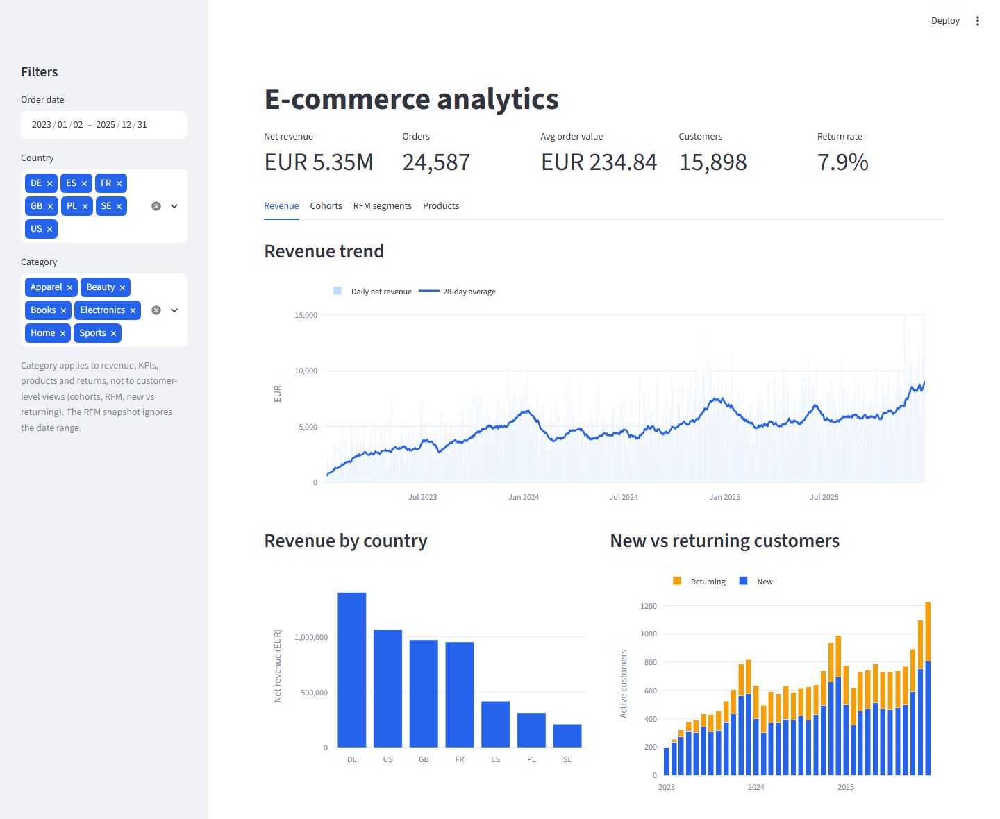
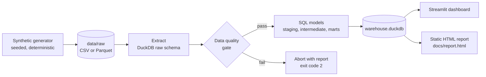
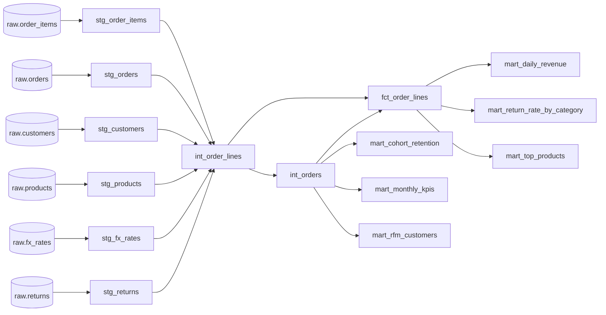

# E-commerce Analytics Pipeline

[](https://github.com/Aleksa5000/ecommerce-analytics-pipeline/actions/workflows/ci.yml)


An end-to-end analytics project: a **config-driven ELT pipeline** (Python + DuckDB), a **layered SQL model**
(staging, intermediate, marts), a **data quality gate** that fails loudly, and an **interactive dashboard**
(Streamlit + Plotly). One command builds the warehouse; one command exports a static report.

**Live report (no install needed):** https://aleksa5000.github.io/ecommerce-analytics-pipeline/report.html
*(served from `/docs` via GitHub Pages; the same self-contained file is [`docs/report.html`](docs/report.html))*



## Business questions it answers

| Question | Where |
|---|---|
| How is revenue trending, and how strong is the Nov/Dec peak? | `mart_daily_revenue` |
| What are monthly orders, AOV and new vs returning customers? | `mart_monthly_kpis` |
| Do customers come back? How fast does each acquisition cohort decay? | `mart_cohort_retention` |
| Who are my best and at-risk customers? | `mart_rfm_customers` (RFM segments) |
| Which products drive revenue, and which get returned? | `mart_top_products`, `mart_return_rate_by_category` |
| What is revenue across 5 currencies in one comparable number? | all marts, normalized to EUR at the monthly FX rate |

## Architecture



### Model lineage

Generated from the SQL itself by `python -m pipeline lineage` (models declare dependencies with
`{{ ref('...') }}` / `{{ source('...') }}`, and the runner builds them in topological order, like dbt).



**Key modeling decisions** (all documented in the SQL):

- Only `completed` orders count as revenue. Cancelled orders are excluded.
- Net revenue = gross (after discount) minus refunds. A returned line is refunded in full, recognised on the order date.
- EUR conversion uses the FX rate of the order month, per currency.
- AOV = gross revenue / orders (before refunds).
- Cohorts use the month of a customer's first completed order, and the retention grid is complete (zero-activity months are rows with 0, not gaps).
- RFM: recency and monetary are quintile scores (customers with the same recency share one R score), frequency uses fixed thresholds (order counts are heavily tied). Segments are defined on R and F; M is a per-customer ranking score and does not affect the segment. Segments: Champions, Loyal, Potential Loyalists, New Customers, Needs Attention, At Risk, Hibernating, Lost.

## Quickstart

```bash
git clone https://github.com/Aleksa5000/ecommerce-analytics-pipeline.git
cd ecommerce-analytics-pipeline
python -m venv .venv && source .venv/bin/activate   # Windows: .venv\Scripts\activate
pip install -e ".[dev]"

python -m pipeline run            # generates data on first run, checks, builds all models
streamlit run dashboard/app.py    # interactive dashboard
python -m pipeline report         # writes docs/report.html (self-contained)
pytest                            # 39 tests
```

`make run | dashboard | report | test | lint` are available as shortcuts.

Configuration is a Pydantic model (`pipeline/config.py`), overridable with environment variables:

| Variable | Default | Meaning |
|---|---|---|
| `PIPELINE_ORDER_LINES` | `50000` | approximate number of order lines to generate |
| `PIPELINE_SEED` | `42` | generator seed (same seed gives byte-identical files) |
| `PIPELINE_FORMAT` | `csv` | `csv` or `parquet` |
| `PIPELINE_DATA_DIR` / `PIPELINE_DB_PATH` | `data/raw`, `data/warehouse.duckdb` | locations |

## The dataset

Deterministic synthetic data (2023-2025): ~16k customers, 120 products in 6 categories, ~25k orders,
~50k order lines, ~4k returns, 7 countries and 5 currencies (EUR, GBP, USD, PLN, SEK) with monthly FX rates.
It has Nov/Dec seasonality, a growth trend, discounts that peak in November, 3% cancelled orders and
category-specific return rates (apparel is highest, books lowest). Raw files land in `data/raw` (gitignored).

## Dashboard

KPI cards (net revenue, orders, AOV, customers, return rate), revenue trend with a 28-day average, revenue by
country, new vs returning customers, cohort retention heatmap, RFM segments, top-products table and return
rate by category. Filters: **date range, country, category**. Category applies to revenue, KPIs, products and
returns. It is not applied to the customer-level views (cohorts, RFM, new vs returning). Cohorts and new vs returning are monthly, so they cover the whole months of the date range, and the RFM snapshot ignores the date range (the sidebar says so).

## Data quality

28 declarative checks run on the raw layer **before** any transformation. A failing check aborts the run with a
readable report (check name, failing row count, sample of offending rows) and exit code `2`, so bad data never
reaches the marts. Results are also stored in `ops.dq_results`.

| Kind | Examples |
|---|---|
| not null | customer_id, order_id, order_date, signup_date |
| unique | customer_id, order_id, order_item_id, (month, currency) of FX rates |
| referential integrity | orders to customers, orders to FX rates (currency + month), order_items to orders and products, returns to order_items |
| accepted values | country, product category, order status, currency |
| expressions | quantity > 0, unit_price > 0, 0 <= discount < 1, FX rate > 0 |

Example failure output (4,000-line sample, order 1 pointed at a customer that does not exist;
abridged: `...` stands for the PASS lines that are cut):

```
[3/4] Data quality checks
Data quality: 27/28 checks passed
  PASS  customers.customer_id not null
  ...
  FAIL  orders.customer_id references customers.customer_id  (1 failing rows)
         order_id  customer_id order_date currency    status
                1     99999999 2023-01-03      EUR completed
  ...

PIPELINE ABORTED - data quality checks failed
1 of 28 checks failed:
  FAIL  orders.customer_id references customers.customer_id  (1 failing rows)
         order_id  customer_id order_date currency    status
                1     99999999 2023-01-03      EUR completed
```

## Tests

`pytest` runs 39 tests:

- **Generator:** same seed gives byte-identical files, different seed differs, size and shape, Nov seasonality, Parquet.
- **Quality:** the clean fixture passes all checks, and 16 injected defects (including a missing FX rate) are each caught by the right check. The failure report is readable, and the error repeats only the failed checks.
- **Marts:** hand-verified numbers on a 3-customer fixture (EUR conversion, daily revenue, new vs returning, the full cohort matrix, RFM scores and segments, top products, return rates, filters). The expected values are derived by hand in the docstring of `tests/test_marts.py`. Every mart reconciles to the same net revenue.
- **End to end:** full pipeline plus report on a small sample (every completed raw order line reaches the fact table), and a corrupted raw file aborts the run before transformation.
- **Dashboard:** a Streamlit `AppTest` smoke test runs `dashboard/app.py` against a fresh small warehouse.

CI (`.github/workflows/ci.yml`, Ubuntu, Python 3.11 and 3.12): install, `ruff check`, `ruff format --check`, `pytest`,
then the pipeline and report end to end on a 4,000-line sample (`PIPELINE_ORDER_LINES=4000`).

## Project structure

```
pipeline/            generator.py  config.py  quality.py  runner.py  analytics.py  charts.py  report.py  cli.py
sql/staging/         type casting and cleaning of each raw table
sql/intermediate/    int_order_lines (joins + EUR conversion + refunds), int_orders
sql/marts/           fct_order_lines + 6 analytical marts
dashboard/app.py     Streamlit app (reads the marts via pipeline.analytics)
tests/               generator, quality, marts (hand-verified), end-to-end
docs/                report.html (committed, served by GitHub Pages), dashboard.png
.github/workflows/   CI
```

## Design notes

- **Why DuckDB?** Zero-infrastructure columnar warehouse: the whole project runs on a laptop and in CI. The SQL is
  ANSI-style and ports to Snowflake, BigQuery or Postgres with small changes.
- **Why a small runner instead of dbt?** It shows the same ideas (layers, `ref()`, DAG order) in about 60 lines,
  with no extra dependencies. The models are plain `.sql` files and drop into a dbt project unchanged apart from the Jinja helpers.
- Charts are built once (`pipeline/charts.py`) and used by both the dashboard and the static report.

## Need something similar?

I build data pipelines, warehouse models and dashboards for e-commerce and SaaS teams.
**Contact me on Upwork** (Aleksa Djorovic) for a project like this.

## License

MIT, see [LICENSE](LICENSE).
